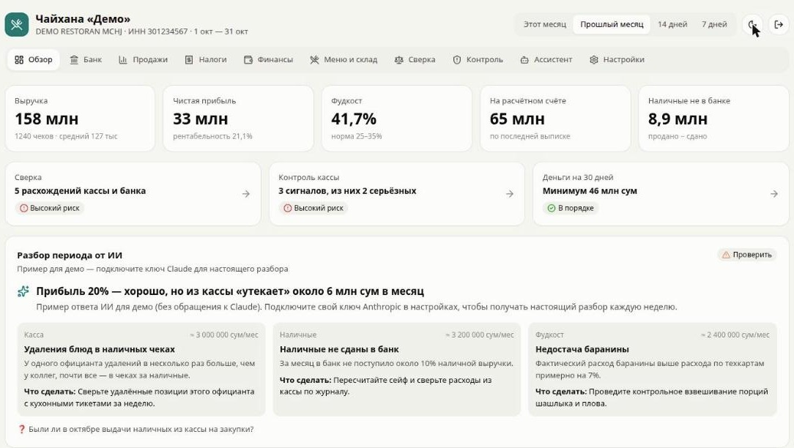
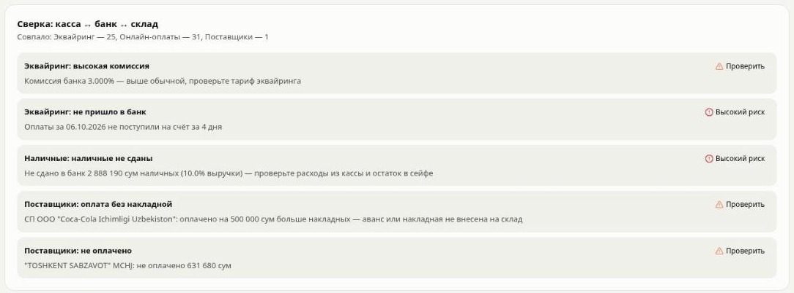
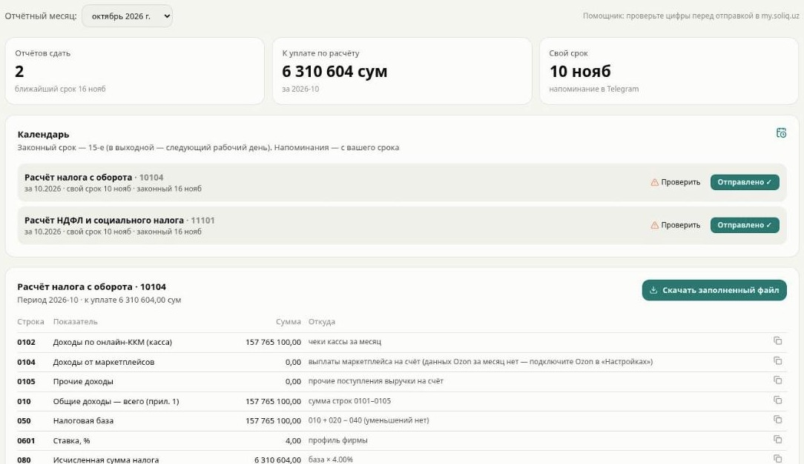
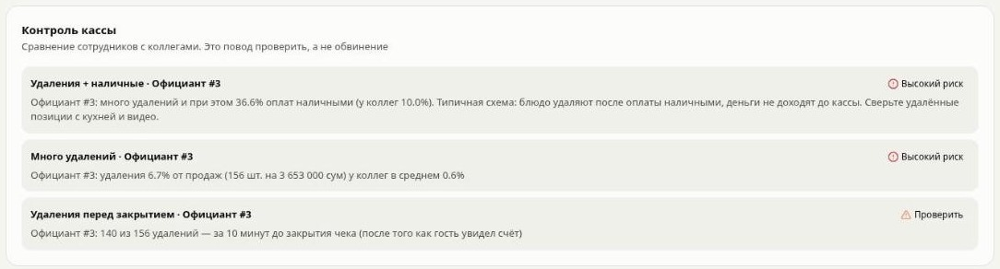
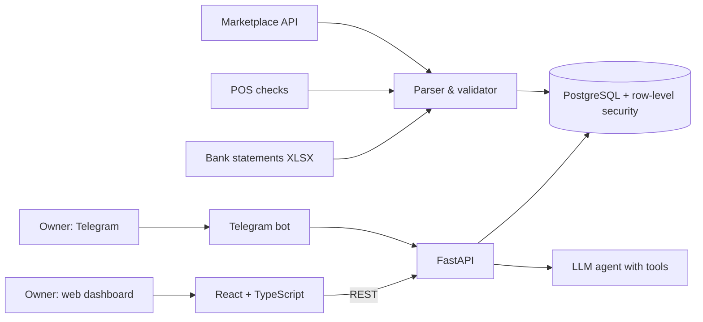

# RestoMetrics — financial control & tax compliance SaaS for SMBs

A multi-tenant platform that turns raw bank, POS and supplier data into financial control, tax reports and plain-language answers for business owners. Screenshots below use a **demo company**.

  
  

  
  

## What it does

- **Bank statement ingestion** — parses corporate bank statements (XLSX) with balance validation, duplicate protection and an ownership check (the statement must belong to the tenant).
- **Smart categorization** — rule-based classification that learns from the owner's manual corrections; counterparty directory.
- **POS ↔ bank ↔ stock reconciliation** — missing card payouts, undeposited cash, supplier payments without invoices, unpaid suppliers.
- **Cash control** — staff anomaly signals: voids after payment, cash-heavy shifts, deletions right before the bill closes.
- **Accounting core** — double-entry ledger generated from source data, trial balance with automatic consistency checks, P&L and a 30-day cash-flow forecast.
- **Tax compliance automation** — monthly tax calculations by statutory report lines, filing calendar with Telegram reminders, accrued vs. paid reconciliation, dividend payout & withholding-tax calculator.
- **Marketplace analytics** — e-commerce marketplace API integration: sales, stock alerts, competitor pricing, loss-making products.
- **AI assistant in Telegram** — instant answers on cash, taxes and sales; LLM agent with tool calling and per-company memory; works without AI for the most common questions.

## Architecture

## Engineering highlights

- **Tenant isolation in the database** — PostgreSQL row-level security; every query runs with the tenant set in the session, so one company can never read another's data. Covered by isolation tests.
- **Privacy** — PII is masked before storage and before anything reaches the LLM; chat identifiers are stored as HMAC + ciphertext.
- **Correctness first** — statements are rejected if opening balance + credits − debits ≠ closing balance; tax figures are traceable to source lines.
- **169 automated tests** (pytest), run against a dedicated test database.

## Stack

Python · FastAPI · psycopg · PostgreSQL (RLS) · React · TypeScript · Vite · Telegram Bot API · LLM APIs (Claude) · Docker · pytest

---
Source code is private (commercial product). Built by [Vladimir Glukhov](https://www.linkedin.com/in/vladimir-glukhov-dev).
